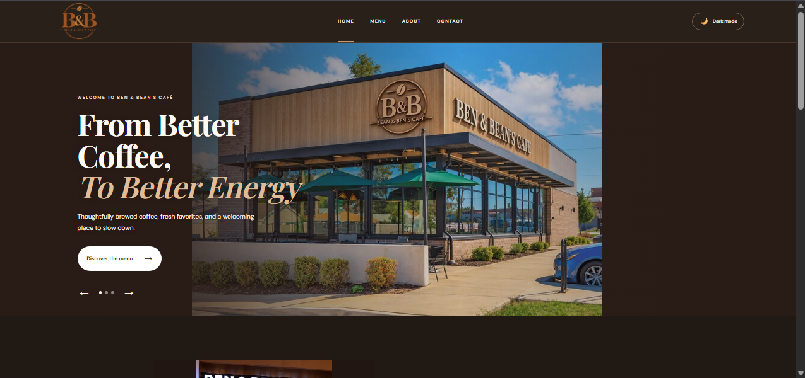
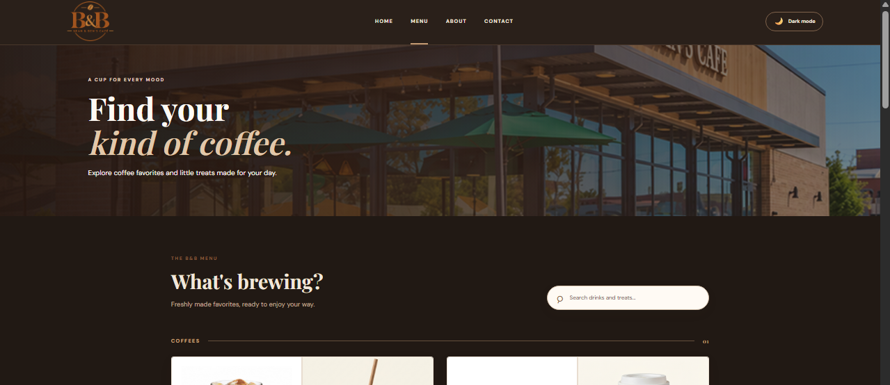
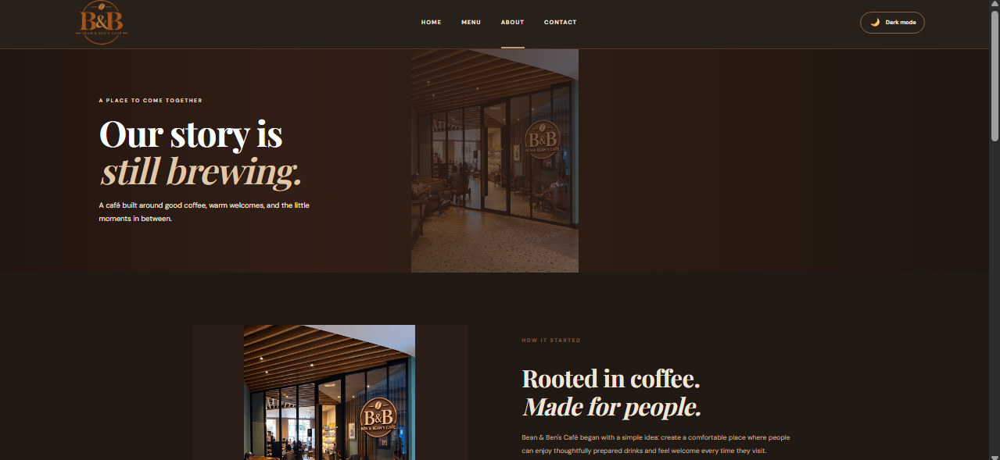
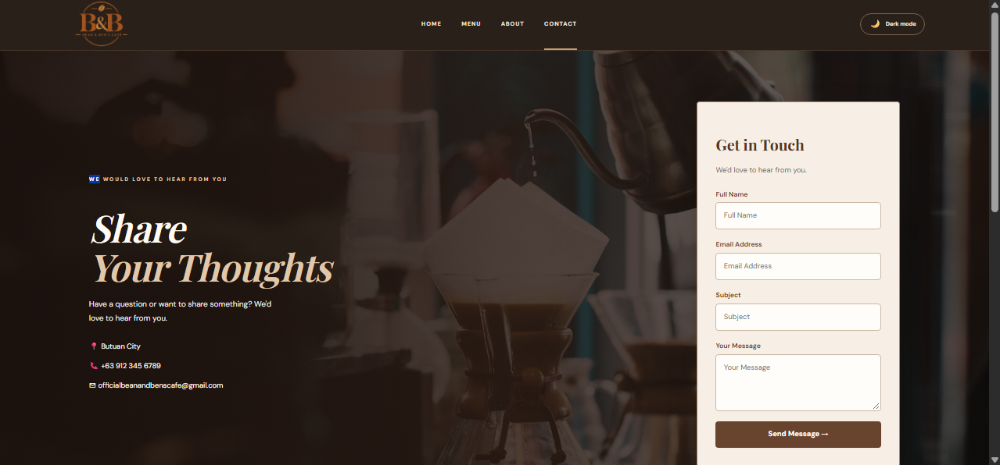

# Ben & Bean's Café

A café restaurant website created as the group project for **IT 110 – Section AIGO1**. The website presents the café through its Home, Menu, About, and Contact pages, with a café-inspired design and light/dark mode.

## Group Information

- **Group Name:** IT 110 GROUP
- **Section:** AIGO1
- **Application Theme:** Café Restaurant

### Group Members and Assigned Modules

| Member | Assigned Module | Branch Name |
|---|---|---|
| **Ben Kristoffer Serrano** | Home Page and Menu Page – Layout | `dev-member-1` |
| **Jhoel Salvador** | About Page and Menu Page – Texts and Pictures | `dev-member-2`* |
| **Andrei Las Piñas** | Contact Page | `dev-member-3`* |

\*The branch names for Members 2 and 3 are suggested to follow the `dev-member-1` naming pattern. Replace them if your GitHub repository uses different branch names.

## Website Screenshots

### 1. Home Page



### 2. Menu Page



### 3. About Page



### 4. Contact Page



## Technologies

- Laravel (PHP framework)
- PHP
- Blade templates
- HTML and CSS
- JavaScript
- MySQL or another database supported by the project's Laravel configuration

## How to Run the Project Locally

Follow these steps to run the Laravel project on your computer.

### Prerequisites

Install the following tools first:

1. **PHP** (a version supported by the Laravel version used in this project)
2. **Composer**
3. **Node.js and npm** (if the project contains frontend build assets in `package.json`)
4. **MySQL** or another database configured by the project, if database features are used
5. **Visual Studio Code** (recommended)
6. **Git** (if cloning the repository)

### Step 1: Clone the GitHub repository

Open a terminal and run:

```bash
git clone <YOUR_GITHUB_REPOSITORY_URL>
```

Move into the project folder:

```bash
cd <PROJECT_FOLDER>
```

Replace the URL and folder name with your actual GitHub repository details.

### Step 2: Install PHP dependencies

```bash
composer install
```

### Step 3: Create the environment file

On Windows Command Prompt:

```bat
copy .env.example .env
```

On macOS/Linux or Git Bash:

```bash
cp .env.example .env
```

### Step 4: Generate the application key

```bash
php artisan key:generate
```

### Step 5: Configure the database (if required)

Open the `.env` file and update the database settings to match your local MySQL setup. For example:

```env
DB_CONNECTION=mysql
DB_HOST=127.0.0.1
DB_PORT=3306
DB_DATABASE=your_database_name
DB_USERNAME=your_database_username
DB_PASSWORD=your_database_password
```

Create the database using your database tool (such as phpMyAdmin) before running migrations.

If the project includes Laravel migrations and requires database tables, run:

```bash
php artisan migrate
```

### Step 6: Install frontend dependencies (if applicable)

If the project contains a `package.json` file, run:

```bash
npm install
npm run build
```

### Step 7: Clear cached views and configuration

```bash
php artisan optimize:clear
```

### Step 8: Start the Laravel development server

```bash
php artisan serve
```

Open the local address shown in the terminal, usually:

```text
http://127.0.0.1:8000
```

The Ben & Bean's Café website should now be accessible in your browser.

## Notes

- Do not upload your `.env` file or database passwords to GitHub.
- Each group member should commit their assigned work to their own branch and coordinate merging through the group's main development branch.
- If the project uses a different database or does not require migrations, follow the configuration already present in the project.
- The screenshots are stored in the `screenshots` folder. Keep that folder in the same repository as this `README.md` so the images display correctly on GitHub.

---

**Project:** Ben & Bean's Café  
**Course:** IT 110  
**Section:** AIGO1  
