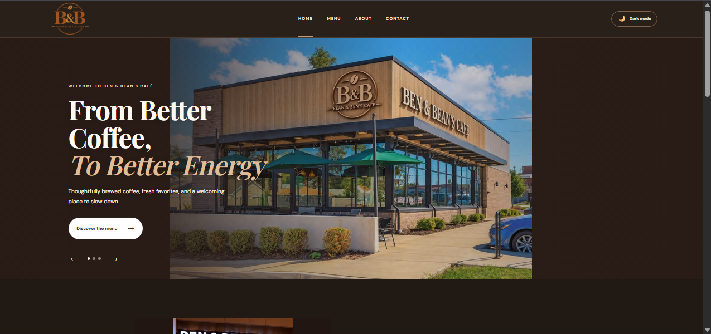
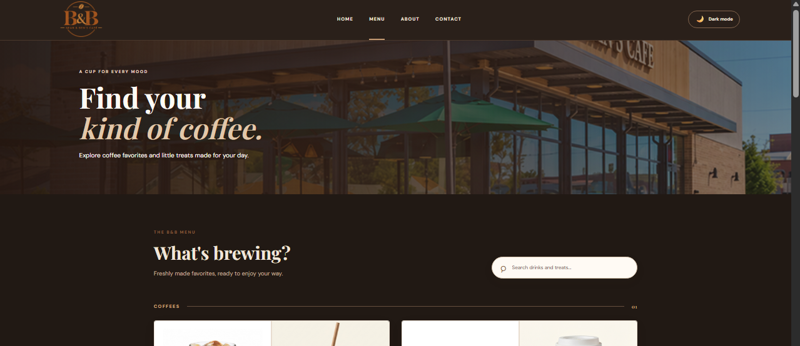
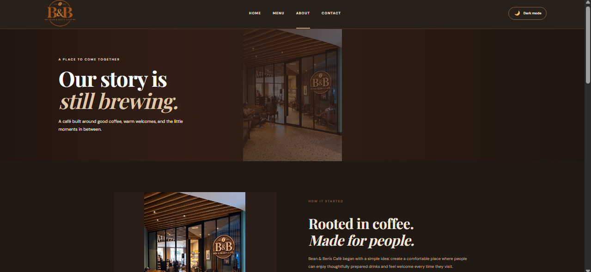
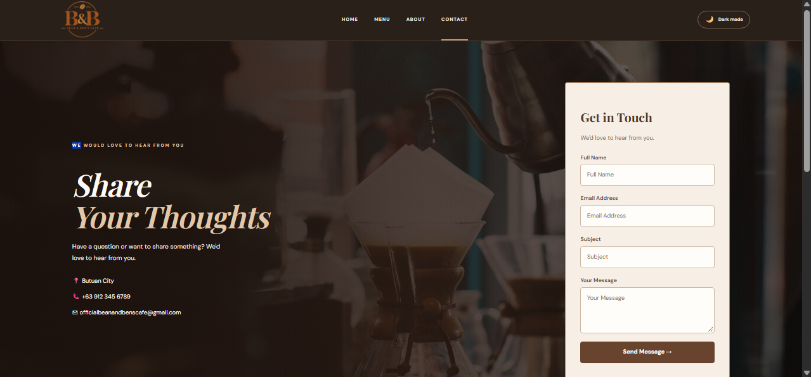

# Ben & Bean's Café

A café restaurant website created as the group project for **IT 110 – Section AIGO1**. The website presents the café through its Home, Menu, About, and Contact pages, with a café-inspired design and light/dark mode.

## Group Information

- **Group Name:** IT 110 GROUP
- **Section:** AIGO1
- **Application Theme:** Café Restaurant

### Group Members and Assigned Modules

| Member | Assigned Module | Branch Name |
|---|---|---|
| **Ben Kristoffer Serrano** | Home Page and Menu Page – Layout | `dev-member-1` |
| **Jhoel Salvador** | About Page and Menu Page – Texts and Pictures | `dev-member-2`* |
| **Andrei Las Piñas** | Contact Page | `dev-member-3`* |

\*The branch names for Members 2 and 3 are suggested to follow the `dev-member-1` naming pattern. Replace them if your GitHub repository uses different branch names.

## Website Screenshots

### 1. Home Page



### 2. Menu Page



### 3. About Page



### 4. Contact Page



## Technologies

- Laravel 12 (PHP Framework)
- PHP 8.2 or higher
- Blade Templates
- HTML and CSS
- JavaScript
- Vite
- Tailwind CSS 4
- SQLite Database

## How to Run the Project Locally

Follow these steps to install and run Ben & Bean's Café on your local computer.

### Prerequisites

Before starting, install the following tools:

1. **PHP 8.2 or higher** – Required to run Laravel.
2. **Composer** – Required to install PHP dependencies.
3. **Node.js (LTS) and npm** – Required to install and build frontend dependencies.
4. **Git** – Required to clone the GitHub repository.
5. **Visual Studio Code** (Recommended) – For viewing and managing the project files.

### Step 1: Clone the GitHub Repository

Open Visual Studio Code or PowerShell and run:

```bash
git clone https://github.com/benkristofferserrano/Lara-Proj-BSIT2A-Serrano-Salvador-LasPinas.git
```

Enter the project directory:

```bash
cd Lara-Proj-BSIT2A-Serrano-Salvador-LasPinas
```

### Step 2: Install PHP Dependencies

Run:

```bash
composer install
```

Wait for Composer to finish installing the required Laravel dependencies.

### Step 3: Create the Environment File

Create a local `.env` file by copying the example configuration.

For Windows PowerShell:

```powershell
Copy-Item .env.example .env
```

For macOS/Linux or Git Bash:

```bash
cp .env.example .env
```

### Step 4: Generate the Application Key

Run:

```bash
php artisan key:generate
```

This generates the application key required by Laravel.

### Step 5: Prepare the SQLite Database

This project uses SQLite as its database.

The `.env.example` file is already configured to use SQLite:

```env
DB_CONNECTION=sqlite
```

For Windows PowerShell, create the database file if it does not already exist:

```powershell
if (!(Test-Path database/database.sqlite)) {
    New-Item -ItemType File -Path database/database.sqlite
}
```

Run the database migrations:

```bash
php artisan migrate
```

This creates the required database tables for the application.

No separate MySQL server or phpMyAdmin setup is required.

### Step 6: Install Frontend Dependencies

Make sure Node.js and npm are installed before proceeding.

Run:

```bash
npm install
```

After installing the dependencies, build the frontend assets:

```bash
npm run build
```

**Note:** If the `npm` command is not recognized, install Node.js LTS from https://nodejs.org/ and restart your terminal or Visual Studio Code.

### Step 7: Clear Laravel Cache

Run:

```bash
php artisan optimize:clear
```

This clears cached configuration, routes, and views.

### Step 8: Start the Laravel Development Server

Run:

```bash
php artisan serve
```

Once the server starts successfully, open your browser and visit:

**http://127.0.0.1:8000**

The Ben & Bean's Café website should now be accessible.

## Notes

- Do not upload your `.env` file or private configuration credentials to GitHub.
- Each group member should commit their assigned work to their respective branch and coordinate merging through the main branch.
- Make sure all required dependencies are installed before running the website.
- The screenshots are stored in the `screenshots` folder. Keep that folder in the same repository as this README file so the images display correctly on GitHub.